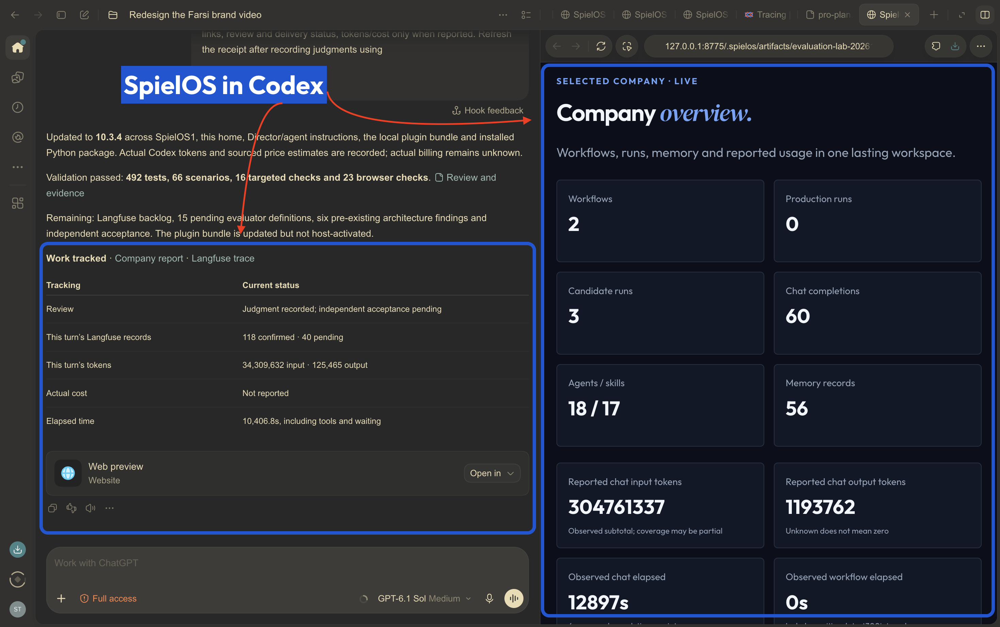

# SpielOS


**Turn recurring company work into workflows you can test and improve.**

Research leads, build outbound and prepare reports with Director. Keep your company facts, strategy, brand, memory and decisions together across conversations — with a dashboard showing what actually happened.

[**Install in ChatGPT desktop / Codex →**](docs/tester-guide.md#chatgpt-and-codex) · [**Install in Claude Code →**](docs/tester-guide.md#claude-code)



*Owner-supplied reference. Historical company counts are not product benchmarks. Fresh installs show their own records and empty states.*

## Give Director a real job

> Director, build an outbound email workflow for **[ICP]**. Research fit, draft personalized emails and require review before sending.

> Build a lead research agent for **[ICP]** that cites its sources and explains each fit score.

> Turn our **[recurring report]** into a workflow. Agree the quality criteria, test real outputs and show what improved.

Director helps define the inputs, sources, permissions, examples and evaluation criteria, then builds and tests a reusable workflow. Sources and integrations are selected for your company. Nothing is sent just because a quality check passed.

## Get started

Choose the **desktop plugin** for guided setup in chat, or install the **Python CLI** for terminal use. Both use the same SpielOS core and company folder format.

### 1. Install Python

**Python 3.11 or newer is required for both routes.** The plugin bundles SpielOS code, not the Python interpreter. Node.js is not required for the Python CLI or desktop plugin.

- **macOS / Windows:** install Python from [python.org](https://www.python.org/downloads/), then restart your desktop host.
- **Linux:** install Python 3.11+ through your distribution's package manager.
- **Plugin prerequisite:** `python3 --version` must work. On Windows, if only `py` or `python` works, follow [Python's Windows alias troubleshooting](https://docs.python.org/3/using/windows.html#troubleshooting). Having Python installed under another command alone does not satisfy the current plugin launcher.

### 2a. Desktop plugin

[Public plugin package and installation guide](https://github.com/ShayanSpiel/SpielOS-Plugin) · [Download the ZIP](https://github.com/ShayanSpiel/SpielOS-Plugin/releases/latest)

**Codex:** ask it to install from the **ShayanSpiel/SpielOS-Plugin** GitHub marketplace. Then choose **SpielOS → Setup** in the installed plugin's skills, or type `$spielos:setup`. This is a manual marketplace installation; the public ChatGPT store listing is not approved yet.

**Claude Code:** run these in Claude Code:

```text
/plugin marketplace add ShayanSpiel/SpielOS-Plugin
/plugin install spielos@spielos
/spielos:setup
```

Setup helps you select or create a company folder, checks prerequisites and offers Langfuse connection. Open the selected folder as your host workspace and review its hooks. These instructions apply to Codex and Claude Code with local execution, not ChatGPT web or Claude web.

### 2b. Python CLI alternative

The CLI and its interactive onboarding remain available. On macOS/Linux, install or update from current GitHub source with one command (requires Python 3.11+ and Git):

```sh
curl -fsSL https://raw.githubusercontent.com/ShayanSpiel/SpielOS/main/install.sh | SPIELOS_SOURCE=git+https://github.com/ShayanSpiel/SpielOS.git sh
```

The [installer](install.sh) uses an isolated pipx environment. It installs the CLI; it does not create a company until you select a folder.

For a virtual environment on **macOS/Linux**:

```sh
python3 -m venv .venv
.venv/bin/python -m pip install --upgrade "git+https://github.com/ShayanSpiel/SpielOS.git"
.venv/bin/spielos init --dir ./my-company
```

For **Windows PowerShell**:

```powershell
py -3 -m venv .venv
.\.venv\Scripts\python.exe -m pip install --upgrade "git+https://github.com/ShayanSpiel/SpielOS.git"
.\.venv\Scripts\spielos.exe init --dir .\my-company
```

Run these from a working folder outside the SpielOS source checkout. The Windows example uses the `py` launcher; if your installation exposes `python` instead, use that for the first line. Native Windows qualification is tracked in [CI](https://github.com/ShayanSpiel/SpielOS/actions).

If you used the one-command installer, start interactive onboarding with:

```sh
spielos init --dir ./my-company
```

Then open `my-company` in Codex or Claude Code and ask Director to introduce your company workspace and build your first workflow. CLI initialization creates the home and host configuration; plugin Setup additionally guides the local recording and Langfuse choices.

## Commands you'll use

| Action | Codex plugin | Claude Code plugin | Python CLI |
| --- | --- | --- | --- |
| Create or select a company | `$spielos:setup` | `/spielos:setup` | `spielos init --dir ./my-company` creates one |
| Work with Director | `$spielos:director` | `/spielos:director` | Open the company folder in your host |
| Open the dashboard | `$spielos:dashboard` | `/spielos:dashboard` | `spielos report --home ./my-company` |
| Check company status | Ask Director | Ask Director | `spielos status --home ./my-company` |
| Help | `$spielos:help` | `/spielos:help` | `spielos --help` |

For a virtual-environment installation, replace `spielos` with `.venv/bin/spielos` on macOS/Linux or `.\.venv\Scripts\spielos.exe` on Windows. Codex's `$…` skill invocations and Claude Code's `/…` commands are different host interfaces.

## Updates

**Plugin:** refresh the SpielOS marketplace and update the installed plugin. In Claude Code:

```text
/plugin marketplace update spielos
/plugin update spielos@spielos
```

**Python CLI:** rerun the one-command installer, or rerun your virtual environment's `pip install --upgrade` command above. Then explicitly refresh an existing company:

```sh
spielos update --dir ./my-company
```

Your company folder is separate from the plugin and CLI installation. Company updates preserve owner content; review changed hooks through your host's normal controls.

## Your first conversation

Choose or create a company folder. Setup asks whether to **connect Langfuse now or continue locally**. Project keys go into a private local connection form, never chat. The selected project must verify before export is enabled.

Open that company as your workspace and review its hooks through your host's normal controls. After your first meaningful chat, Director shows your actual dashboard and explains how to read it:

- **Home:** current work, counts and pending decisions.
- **History & examples:** actual runs and outputs; examples remain separate evidence.
- **Quality & learning:** criteria, missing reviews, judgments and the evidence required to prove later improvement.
- **Activity & cost:** exposed token totals and measured intervals. Missing usage and actual billing stay unknown.
- **Memory, Loaded context and Langfuse delivery:** saved facts, what was actually supplied, and queued versus remotely confirmed evidence.

Meaningful chats end with a concise **Work tracked** receipt. It is Markdown in the chat, with real dashboard/trace links and review status. Installation alone trusts no hooks and creates no company.

## A portable company. Workflows that improve with evidence.

Your company stays in readable files in the folder you choose, with private state and outputs alongside it. Updating or removing the plugin does not delete that folder. Workflow implementations, context, criteria, inputs and actual outputs remain attributable to their versions.

Experiments use representative, held-out and negative cases. Local tracking, drafts and candidate experiments need no Langfuse account. The current production release policy requires verified Langfuse evidence and independent review. Passing a test alone does not prove a workflow improved or produced business impact.

The dashboard provides inspection and evidence. A complete before/after improvement scorecard is not yet implemented. Activepieces remains inactive; external sending and publishing require exact-action authorization.

[Tester guide: devices, setup, first workflow and updates](docs/tester-guide.md) · [Support](https://github.com/ShayanSpiel/SpielOS/issues)

## For technical reviewers

CLI, host adapters and MCP use one Python workflow core: Company, Workflow, Run and Improvement. Production uses pinned releases and bounded invocations, without an autonomous Goal pursuit loop. The package contains reusable software and neutral templates, never an owner's company or credentials. Source boundary, runtime parity, behavior/scenario checks, installed-wheel journeys and native-platform acceptance remain separate evidence.

This is trusted local software; enterprise isolation and untrusted-code sandboxing are not claimed. See the tester guide for prerequisites and actual platform qualification.

[Operating guide](company/README.md) · [Architecture](company/ARCHITECTURE.md) · [Evaluation standard](company/EVALUATION.md) · [Technical review](docs/reviews/2026-11-02-technical-review.md) · [Privacy](docs/plugin-privacy.md) · [Terms](docs/plugin-terms.md) · [MIT license](LICENSE)
