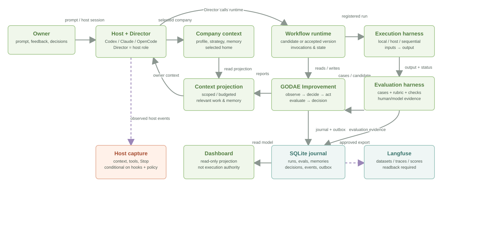
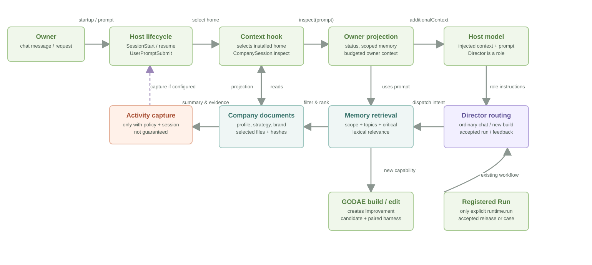
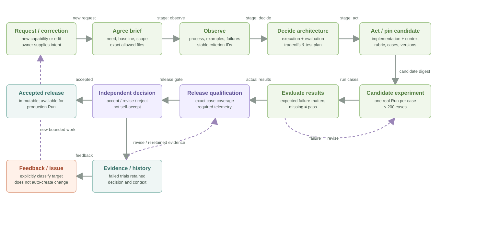
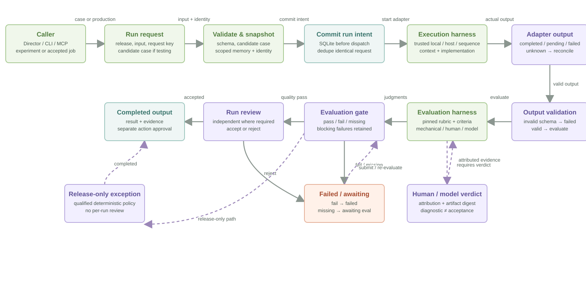
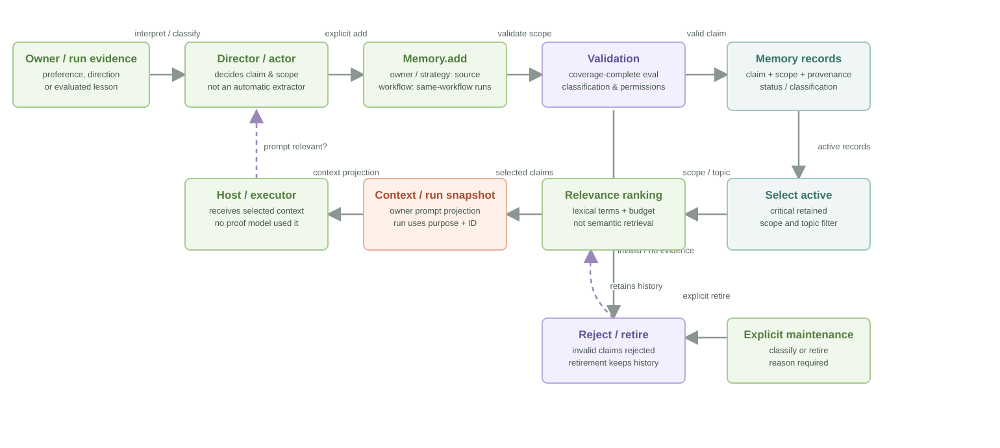
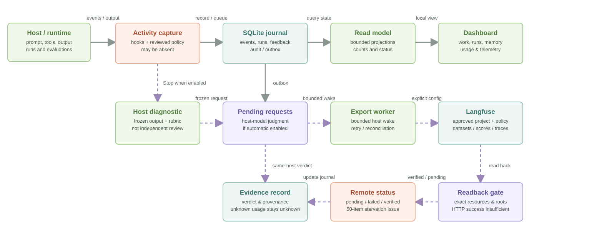
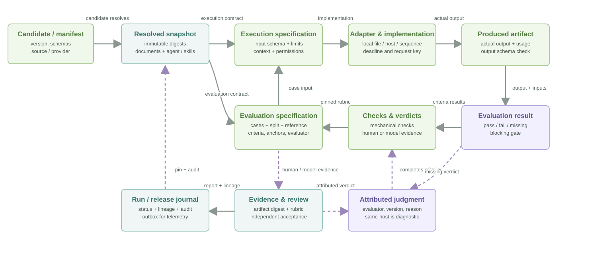
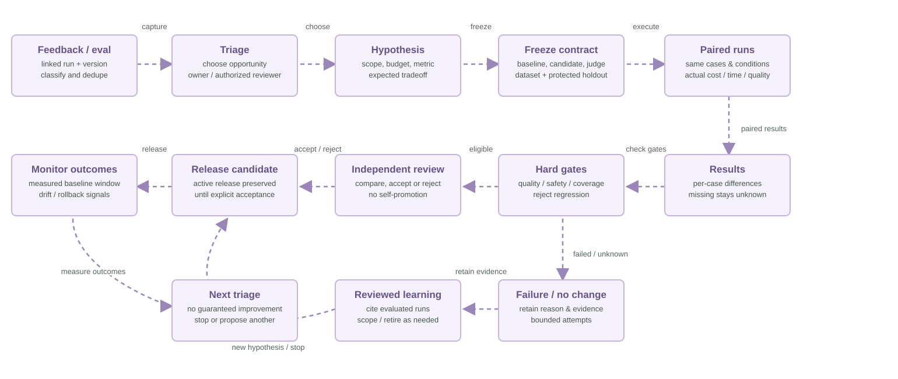

# SpielOS architecture maps

These maps show the implementation as reviewed on 3 November 2026. They describe the workflow runtime and its boundaries, rather than promising autonomous operation. See the [architecture guide](../../company/ARCHITECTURE.md) for context and limitations. The proposed loop is marked separately and is not an implemented feature.

## System overview

## Director and context

## Building and improving a workflow

## Runs and evaluations

## Memory

## Evidence and observability

## Execution and evaluation harnesses

## Proposed experiment loop

This is a design proposal, not an autonomous loop in the current product.

