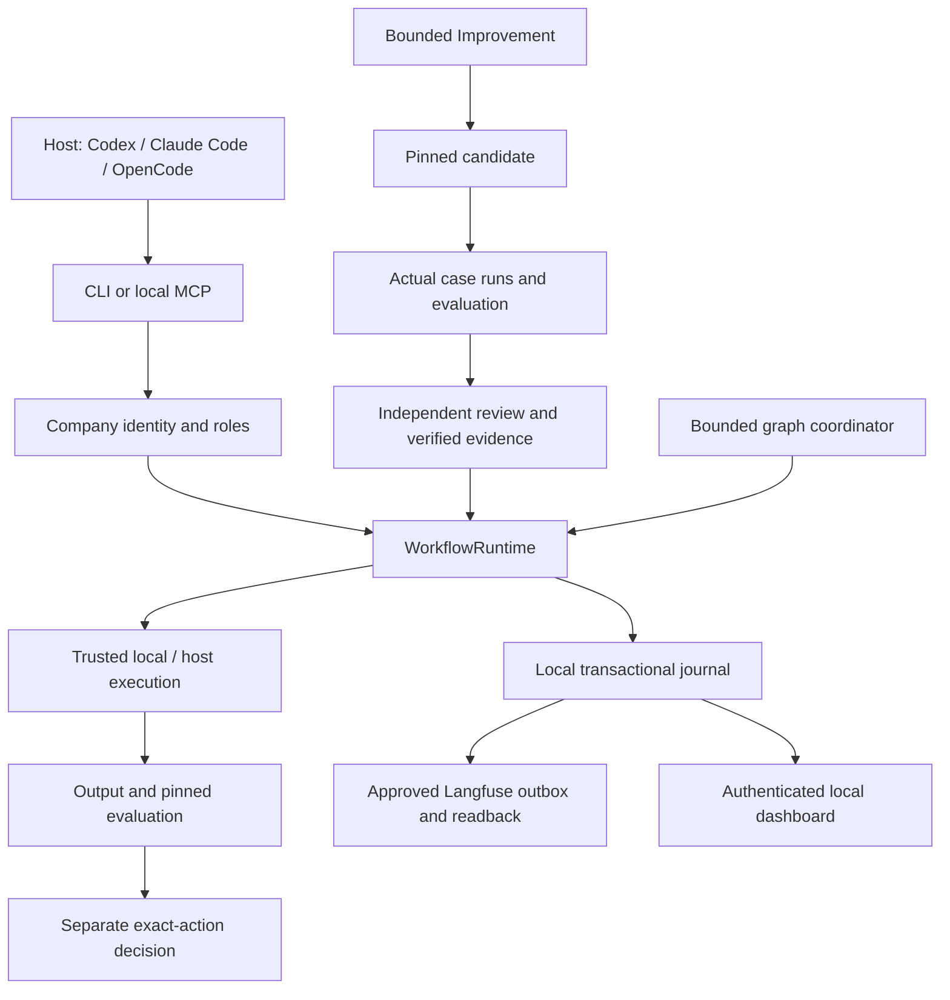

# SpielOS technical review — 2 November 2026

Verdict: a coherent architecture for a trusted local pilot, with meaningful release, evidence and approval contracts. It is not yet justified to claim enterprise isolation, universal portability or independently benchmarked AI quality. The strongest technical story is reproducibility and explicit authority; the next investment should be hardening and simplifying that core.

This review covers the current working tree, including substantial pre-existing uncommitted architecture changes. It combines source inspection, behavior tests, scenario acceptance, an isolated installed-wheel journey, browser checks, dependency health, Ruff and Bandit. It is one review, not an independent security audit or external acceptance. The attached product screenshot is owner-supplied documentation, not proof of current benchmark results.

## Fixed during this review

| Priority | Finding and reproduction | Resolution and evidence |
| --- | --- | --- |
| P1 | Mandatory owner memory was omitted when its topics did not match the current prompt. A privacy constraint retrieved zero records for a sales-report prompt. | `company/context/workflow.py` retains critical claims within the selected scope despite topic mismatch; the projection refuses insufficient mandatory-context budgets. Regression covers unrelated prompts, budget refusal and retirement. |
| P1 | A fresh installed company could not open its dashboard: constructing its read-only runtime attempted to open a workflow database that did not exist. Existing report tests always created a writable runtime first. | `company/reporting.py` reports a valid empty home without creating state. A fresh-home regression and isolated wheel smoke exercise this path before candidate creation. |
| P2 | Rejected memory classification left the claim committed. An invalid category raised an error after one active memory row had already been saved. | Validate classification/permission before insertion; save the claim, classification and audit in one transaction. Regression checks invalid category, topic and critical policy, plus successful retrieval. Activity delivery remains a separately recorded operation. |
| P1 | Release CI still invoked retired `runner tick`, legacy profile/notification commands and asserted the old Goal-only database schema. The current release could never satisfy that journey. | Replace it with `tools/smoke_distribution.py`: isolated installed package, fresh home, read-only inspection, actual three-case experiment, report, update preservation and refusal of retired operation. |
| P2 | The source/runtime parity tool checked current sources but ignored files remaining in the template after their source disappeared. | Report orphan template paths and fail, including with `--write`; never delete implicitly. |
| P2 | The installer could override externally managed Python protection to install pipx, did not select its validated interpreter for pipx, and could miss pipx application executables on PATH. | Remove the `--break-system-packages` fallback, pass the selected Python and include `PIPX_BIN_DIR`/the normal user bin directory. Existing isolated installer journeys pass; global Python was not changed. |
| P2 | Shipped Director instructions contained another product's name and development-conversation directions. Public docs included historical architecture assertions, stale installation guidance and a graph/sequence ambiguity. | Generalize workspace isolation, acceptance and architecture text; refresh README/AGENTS and runtime twins. Public author/repository attribution remains legitimate product metadata. |
| P2 | Homebrew's wrapper bypassed selected-home CLI dispatch. | Delegate through `company.cli`. Its published archive/checksum still intentionally identifies the existing release; do not invent a checksum for an unpublished distribution. |

## Architecture assessment

| Area inspected | What is sound | Limits / next work |
| --- | --- | --- |
| Source/home boundary | Source marker, destination validation and synthetic homes separate product from owner runtime. Boundary audit includes ignored owner roots. | It is a repository policy guard, not exhaustive secret detection. Build directories are excluded, so also inspect the resulting archive. |
| Execution contracts | Candidate manifests pin source, context, harness and rubric/cases. Stable request identities, intent-before-dispatch, claims and leases fence stale delivery. | Pure/draft execution is the shipped target. Accepted releases still depend on an explicitly configured, verified qualification path. |
| Approval and identity | Authenticated company roles, revocation, independent review and exact-action content/destination/scope binding. | Local OS owner controls the trust root and can modify files. This is not protection against a malicious filesystem owner or enterprise SSO. |
| Memory/retrieval | Explicit owner/strategy/workflow scope, same-workflow evaluated evidence, retirement and provenance. Critical rules fail closed on insufficient budget after the fix. | Retrieval is lexical ranking and bounded selection, not semantic/vector search. It loads active rows and classification maps before selection; large-company latency and relevance need actual measurements. |
| Host hooks and agents | Selected-home context, explicit fallback, bounded same-host review, no implied independent acceptance or hidden agent launch. | Hook execution is host/version/trust dependent. Scripts use PATH `python3`; tests invoke the current interpreter, so a passing fixture does not establish that a GUI host uses Python 3.11+. End-to-end host qualification remains required. |
| Evaluations/experiments | Representative, held-out and negative cases, blocking criteria, actual output evidence, independent calibration and versioned experiment records. | Synthetic checks establish software behavior, not model usefulness or creative quality. No external leaderboard or human quality benchmark was run. |
| Langfuse | Approved destination/payload policy, stable export identity, bounded retry, pending/error states and exact remote readback. | Real provider qualification was not performed. Scopes may contain approved inspectable content; digests-only and reviewed-evidence are different privacy policies. |
| Dashboard | Loopback binding, scoped authentication cookie, private-path exclusions, symlink checks and explicit same-origin file reveal. Real browser tests exercised the main views and memory search. | It is a local trusted view, not a hosted multitenant application. Custom HTML shares a trusted company origin; it must be trusted like local executable content. |
| Portability/import/update | Dependency closure, hashes, static preview, no import-time execution or inherited release approvals. Selected-home updates preserve owner content. | `fcntl`, POSIX user identity and symlinks prevent claiming native Windows support. Copied homes need their host paths/environment reviewed. Do not share SQLite through Git/network drives. |
| Graph | Workflow nodes delegate to WorkflowRuntime; inspect nodes explicitly report source integrity only. Recovery and protected comparison tests exist. | Source-reference inspection is not execution of a Director/model. The graph journal is supplementary authority and does not qualify releases. |
| Legacy code | Retired commands are refused; historical compatibility remains testable/readable. | Large Goal/engine compatibility modules still ship. Preserve them until a declared compatibility boundary, then separate or retire deliberately. |

## Remaining priorities

1. **P2 — Qualify hook interpreter selection.** Bind or validate the supported interpreter in host launch paths, with a relocation/update policy. Test an actual GUI-launched host with PATH resolving to an old Python and make failure visible. This machine's system Python is 3.9.6 while normal shell Python is 3.14.4. A healthy CLI does not prove healthy hooks.
2. **P2 — Bound trusted subprocess resources.** `LocalFileAdapter` uses a timeout and checks stdout length after `capture_output`; those do not bound memory while output is accumulating or guarantee termination of every descendant process. Add streaming output limits and process-group cancellation before broader unattended use. This review does not claim an exploit or untrusted-code isolation.
3. **P2 — Simplify the maintenance surface.** The inspected operational source contains 78 Python modules, around 15,000 lines, with `WorkflowRuntime` around 1,200 lines and larger historical engine/controller modules. Extract state transitions, evaluation and export behind tests as separately bounded Improvements. Do not perform a cosmetic rewrite or delete compatibility evidence.
4. **P2 — Establish quality/performance evidence beyond fixtures.** Measure retrieval relevance, hook latency, realistic database/report scale, independent reviewer outcomes and production-like recovery. Preserve population, versions, environment and outcome windows. Current local passing counts do not answer those questions.
5. **P2 — Review remaining static findings incrementally.** Ruff reports 87 F-rule findings, primarily unused imports/locals across current and historical code plus tests. Bandit reports 43 findings (22 medium, 21 low; no high). These are raw tool findings, not confirmed vulnerabilities. Sampled SQL flags use fixed allowlists/placeholders; report URL-open and process boundaries still warrant explicit contracts. No blanket suppression or unreviewed autofix was applied.
6. **Release qualification — Run the new hosted matrix.** New CI is configured for macOS/Linux and Python 3.11/3.12/3.14. Local evidence below does not establish outcomes on the other OS/interpreter combinations. Native Windows, enterprise isolation and live remote providers remain unqualified.

## Python and distribution health

Normal shell Python 3.14.4 passed `pip check`. The pipx SpielOS environment uses Python 3.14.7, reports package/runtime 10.3.4 and passes dependency consistency. `pipx list --short` still labels it 10.3.3: inventory metadata and installed distribution disagree. Reinstall through the standard supported installer when updating; no global environment or installed company was modified by this review.

A built wheel contained 252 company files with no orphan source paths, bytecode, private runtime roots or `.env` path. The isolated environment installs that wheel and runs outside the checkout with Python isolated mode and no inherited source/template/principal overrides. This prevents accidental imports from source from masquerading as installed-package acceptance.

## Acceptance evidence

Final local evidence is recorded outside source under `/tmp/spielos-review-*`:

| Check | Observed evidence |
| --- | --- |
| Unit regression suite | 497 tests passed (`spielos-review-final-tests.log`). |
| Scenario acceptance | 66 declared scenarios, with actual per-test evidence and source fingerprint in `spielos-review-acceptance-final.json`. |
| Targeted regression/installer checks | 18 tests passed after the added mandatory-memory, atomic-write and fresh-report regressions. |
| Isolated installed wheel | 14 CLI checks passed, including actual representative/held-out/negative case execution and preserved owner voice after update (`spielos-review-smoke.json`). |
| Browser | Six main sections, live memory filtering, no page errors, and 390px viewport/document width both 390 (`spielos-review-browser.json`). |
| Source contracts | Boundary audit clean; runtime twins byte-identical; source syntax parses; architecture source references validate. |
| Static analysis | Ruff 0.17.3 and Bandit 1.9.4 raw reports; findings remain visible as described above. |
| Dependencies | Shell and pipx dependency checks pass; package/runtime version matches 10.3.4, with stale pipx inventory label noted. |

Reproduce the core checks with the README commands. For wheel verification, build and install in a fresh environment, then run `python3 -B tools/smoke_distribution.py --python /absolute/path/to/venv/bin/python --expected 10.3.4`. `tools/capture_docs.py` prepares only a synthetic home and real command/hook transcript outside source; it never starts a model session or qualifies one.

No package-registry release, paid model benchmark, live Activepieces action or independent acceptance is asserted. The owner separately authorized committing/pushing the current source and refreshing GitHub repository presentation.

GitHub presentation: the description and topics now emphasize lasting context, bounded workflows, versioned evaluations, Langfuse experiments and explicit approvals across supported hosts. The existing product homepage is preserved.
